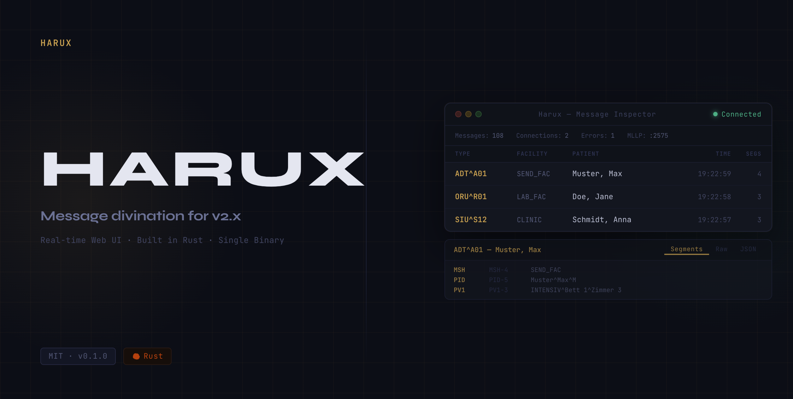

<div align="center">



<br/>
<br/>

[](https://github.com/Pappet/harux/actions)
[](https://github.com/Pappet/harux/releases)
[](LICENSE)
[](https://www.rust-lang.org/)

<br/>

**Harux** is a high-performance MLLP server with a real-time web UI for inspecting HL7 v2.x messages — built in Rust, deployed as a single binary.

It receives and inspects messages as a central service the whole team reaches through the browser — no local setup, no RDP-exclusive windows. It covers the receiving and inspecting side of a desktop HL7 inspector today; sending, editing and replay, and persistence across restarts are on the [roadmap](docs/ROADMAP.md) (Milestones 4 and 5).

<br/>

[**Download**](https://github.com/Pappet/harux/releases) · [**Docs**](#-documentation) · [**Quickstart**](#-quick-start)

</div>

---

## Features

- **MLLP Server** — async TCP listener with correct `0x0B`/`0x1C 0x0D` framing, ACK in the sender's own delimiters, NACK for unparseable frames, `AR` for oversized ones; no frame is dropped silently — broken ones are stored with their parse error
- **Charset-aware** — decodes payloads per MSH-18 (e.g. `8859/1`) and warns instead of producing mojibake when the declared charset doesn't fit
- **Real-time Web UI** — browser SPA with WebSocket push, modern typography, two-line message layout, and time-bucket group headers
- **Accessibility** — full keyboard navigation (`Tab` focus) and Enter/Space activation for screen-reader and keyboard-only workflows
- **Deep HL7 Parser** — dynamic delimiter detection, repetitions, components, sub-components and escape sequences
- **Five Message Views** — Parsed segments, Raw HL7, sent ACK/NACK, JSON, and Segment Diff
- **HL7 Dictionary Tooltips** — hover any field or segment header for its official HL7 v2.5.1 description; no internet required
- **Message Type Detection** — human-readable type description and typical segments checklist per message
- **Validation Engine** — warnings for missing required segments (red) and fields (amber) per message type, and for invalid NM/DT/TS/SI values such as impossible dates (blue); non-blocking, all messages are stored regardless
- **Validation Filter** — one-click filter to show only messages with warnings or errors; also supports `has:warnings` / `has:errors` search prefixes
- **Segment Diff** — pin any message as a reference and compare it field-by-field, with repeated segments paired by name and occurrence; optional toggle to hide always-changing dynamic fields (MSH-7, MSH-10)
- **Search & Filter** — global shortcut `Cmd+K` to search the loaded messages by message type, patient name, facility, message control ID, source IP
- **Bookmark & Tag** — bookmark important messages, add custom text tags; bookmarks are protected from eviction within a configurable share of the store (`store.bookmark_budget_percent`, default 50 %) and survive a page reload
- **Session-based Views** — each developer sees their own filters, selection, and scroll position
- **Source Rail** — always-visible rail of color-coded source chips to instantly visually distinguish and filter by sender system/IP
- **Smart Store** — in-memory with configurable capacity and dual eviction (count + real memory size); messages are lost on restart
- **HL7 Export** — download every stored message as one MLLP-framed `.hl7` file, byte for byte as received, ready to replay with any MLLP sender
- **Resizable Panels** — drag splitter between message list and detail view
- **Configurable** — `harux.toml` for ports, bind addresses, allowed host names, memory limits, timeouts, log level and log retention; a broken configuration stops the start with a clear error
- **Network-aware** — refuses cross-site and DNS-rebinding requests; no authentication or TLS, so place it on a trusted network (see [SECURITY.md](SECURITY.md))
- **Single Binary** — frontend embedded via `rust-embed`, zero runtime dependencies

---

## Quick Start

**Prerequisites:** [Rust toolchain](https://rustup.rs)

```bash
git clone https://github.com/Pappet/harux.git
cd harux
cargo build --release
cargo run --release
```

Open **http://localhost:8080** — the UI connects automatically.

**Defaults:** MLLP port `2575`, Web UI port `8080`, both on all interfaces. Override via `harux.toml` or environment variables (`MLLP_PORT`, `WEB_PORT`, `RUST_LOG`). [`examples/harux-example.toml`](examples/harux-example.toml) lists every key with its default. If users open the UI by a DNS name, add it to `server.allowed_hosts`.

### Windows

```powershell
# Direct start
.\harux.exe

# Install as Windows Service (NSSM)
nssm install Harux C:\Tools\harux.exe
nssm start Harux
```

Pre-built binaries for Windows, macOS, and Linux are available on the [Releases](https://github.com/Pappet/harux/releases) page.

---

## Documentation

| Document | Description |
|---|---|
| [PROJECT_OVERVIEW.md](docs/PROJECT_OVERVIEW.md) | Architecture, technical decisions, configuration and API reference |
| [ROADMAP.md](docs/ROADMAP.md) | Milestones, planned features, and progress tracking |
| [STYLE_GUIDE.md](docs/STYLE_GUIDE.md) | UI design rules, coding conventions, workflow standards |
| [CHANGELOG.md](CHANGELOG.md) | Full history of every change |
| [CONTRIBUTING.md](CONTRIBUTING.md) | How to contribute |
| [SECURITY.md](SECURITY.md) | Deployment security and how to report vulnerabilities |
| [AGENTS.md](AGENTS.md) | Detailed developer and AI-agent guide (architecture, constraints) |

---

## Contributing

Contributions are welcome. Please open an issue first for larger changes.

```bash
git checkout -b feat/<issue>-my-feature
cargo fmt --check && cargo clippy -- -D warnings && cargo test
node --test 'tests/js/*.test.mjs'
# Submit a pull request against main
```

---

## License

MIT — see [LICENSE](LICENSE) for the full text.

---

<div align="center">
<sub>Built with Rust · <a href="https://github.com/Pappet/harux">github.com/Pappet/harux</a></sub>
</div>
